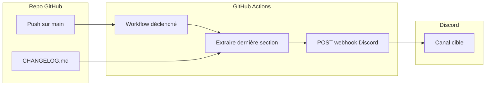

# Publication automatique du changelog sur Discord

Documentation pour la configuration future : envoyer automatiquement les derniers ajouts du CHANGELOG vers un canal Discord.

## Principe

Utiliser un **webhook Discord** + une **GitHub Action** qui, à chaque push sur `main` où `CHANGELOG.md` a été modifié, extrait la **dernière section** du changelog (la plus récente, ex. `## [2026-02-22]`) et l'envoie dans un canal Discord.

## Prérequis côté Discord

1. Sur ton serveur Discord : **Paramètres du serveur > Intégrations > Webhooks > Nouveau webhook**.
2. Choisir le **canal** où publier les annonces (ex. `#annonces` ou `#dev`).
3. Copier l'**URL du webhook** (elle contient un token secret).

## Prérequis côté GitHub

1. Dans le dépôt : **Settings > Secrets and variables > Actions**.
2. Créer un secret nommé **`DISCORD_WEBHOOK_URL`** et y coller l'URL du webhook Discord.

## Implémentation proposée

### 1. Workflow GitHub Actions

Créer `.github/workflows/changelog-to-discord.yml` :

- **Déclencheur** : `push` sur la branche `main`, avec un filtre pour ne lancer le job que si `CHANGELOG.md` fait partie des fichiers modifiés (avec `paths` ou en vérifiant dans le job).
- **Job unique** :
  - Checkout du repo.
  - **Extraire la dernière section** du changelog : tout le bloc entre le premier `## [YYYY-MM-DD]` et le prochain `---` ou `##` (ex. avec un script shell ou Node minimal). Le format de `CHANGELOG.md` (titres `## [date]` puis `### Ajouté / Modifié / Supprimé`) s'y prête bien.
  - **Envoyer à Discord** : `POST` vers l'URL du webhook avec un body JSON. Discord accepte :
    - **Message simple** : `{"content": "..."}` (texte brut ou markdown limité).
    - **Embed** (recommandé) : `{"embeds": [{"title": "Nouveautés – [date]", "description": "...", "color": ...}]}` pour un rendu plus lisible (titre, bloc de texte formaté).

Limite Discord : 2000 caractères par message (et 4096 pour l'`description` d'un embed). Si la section dépasse, on peut tronquer avec un message du type « *… (suite dans le CHANGELOG)* » ou envoyer en plusieurs messages.

### 2. Extraction de la dernière section

Deux options :

- **Shell (sed/awk)** : repérer les numéros de lignes du premier `## [` et du prochain `---` ou `##`, puis extraire les lignes entre les deux. Simple et sans dépendance.
- **Script Node** : fichier `.github/scripts/extract-latest-changelog.js` qui lit `CHANGELOG.md`, parse les sections (ex. par regex ou split sur `##`), renvoie la première section en texte. Plus robuste si le format évolue.

Recommandation : commencer par du **shell** dans le workflow pour rester léger ; passer à un petit script Node si le format du changelog se complexifie.

### 3. Sécurité

- L'URL du webhook ne doit **jamais** apparaître dans le code : uniquement dans le secret **`DISCORD_WEBHOOK_URL`**, référencé dans le workflow par `${{ secrets.DISCORD_WEBHOOK_URL }}`.
- Ne pas logger le contenu du secret dans les steps.

## Résumé des fichiers

| Fichier | Action |
|--------|--------|
| `.github/workflows/changelog-to-discord.yml` | Créer : workflow déclenché sur push main (si CHANGELOG modifié), extraction dernière section, envoi webhook Discord. |

Aucune modification de `CHANGELOG.md` ou du reste du projet n'est nécessaire ; le format actuel du fichier convient.

## Déclenchement

- **Quand** : à chaque push sur `main` qui modifie `CHANGELOG.md`.
- **Contenu envoyé** : uniquement la **dernière section** (la plus récente en haut du fichier), pour éviter de renvoyer tout l'historique à chaque fois.

Si tu veux un déclenchement différent (ex. à chaque déploiement Vercel, ou à chaque tag/release), on peut adapter le déclencheur du workflow en conséquence.
